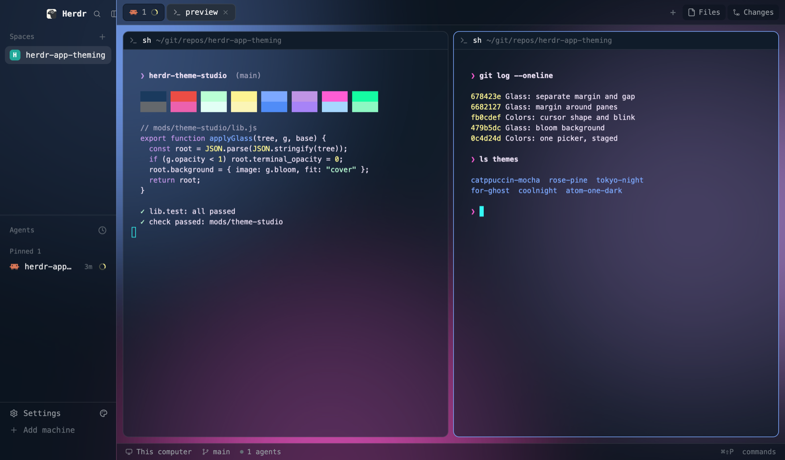
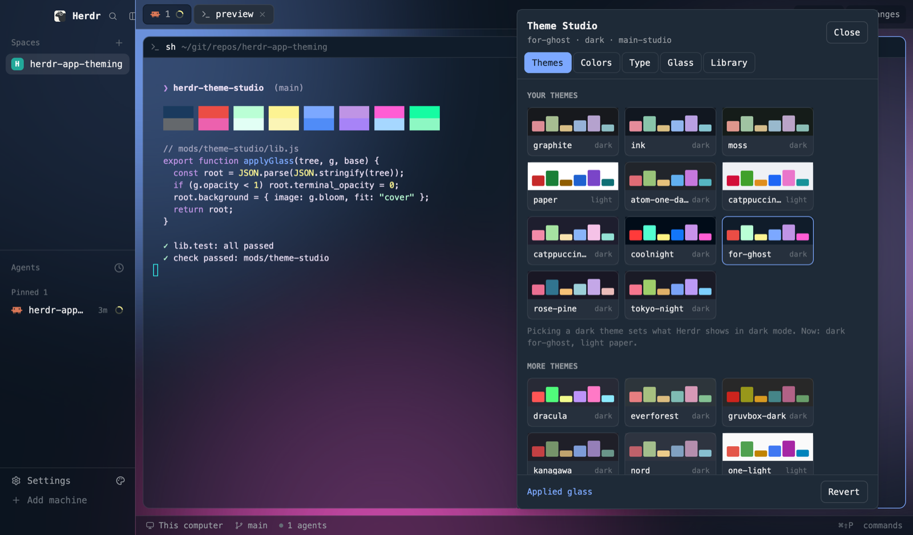

# Theme Studio, a Herdr mod

One window for the [Herdr](https://herdr.dev) app's whole look: themes, every color token,
fonts, glass and pane frames. Changes show in the real window as you make them, because the
Studio edits the files Herdr already redraws from. [RECIPE.md](RECIPE.md) is the brief to
build it from scratch.


| Bloom glass, Studio closed | Colors and cursor | Themes |
|---|---|---|
|  |  |  |

## Install

On [herdr.dev/mods](https://herdr.dev/mods), copy Theme Studio's line and give it to your agent.
It copies `mods/theme-studio/` into `~/.config/herdr-app/mods/` and merges `keys.json` into yours.
Then press `ctrl-shift-y`. By hand: copy that folder yourself and add
`"ctrl-shift-y": "mod.open:theme-studio"` to the `global` section of your `keys.json`.

Your agent will mention that the Studio runs programs and reads files outside its folder. It runs
`osascript` to blur the wallpaper and render Bloom, and it reads `.itermcolors` files in Downloads and on
the Desktop for import.

Requires Herdr app 0.1.13 or later on macOS (Frosted wallpaper and Bloom are macOS only).

**Working on the source:** `./install.sh` copies `mods/theme-studio` into `~/.config/herdr-app` and
binds `ctrl-shift-y` (needs node). `./install.sh --remove` takes both out; your themes, settings and
layouts stay. Re-run it after each edit: Herdr's hot reload doesn't follow symlinks, so it copies. An
open Studio window keeps its old build until you close and reopen it.

## Updating

Herdr mods have no update channel, so check the
[tags](https://github.com/agentic-tool-labs/herdr-theme-studio/tags) for a newer version. To update, tell
your agent: "Update Theme Studio from github.com/agentic-tool-labs/herdr-theme-studio: replace my
`mods/theme-studio/` folder with the repo's." Say "replace": by default an agent adds a second copy
under a new name rather than overwrite. Your themes (with their saved type and glass), settings and layouts live outside
that folder and stay. Close and reopen the Studio afterwards.

## Opening it

- **⌃⇧Y** toggles the window.
- **The palette icon beside Settings** in the sidebar footer. Herdr's Settings screen can't take
  extra sections (Herdr rewrites it on every start), and its sidebar mod and built-in layouts can't
  be edited. So the Studio makes your own copy of the layout (`<layout>-studio`) and a patched
  clone of the sidebar mod (`mods/workspace-chrome-studio`) for the footer only. The theme
  manager's Palette icon section adds or removes it. On the narrow sidebar rail it gets its own row under Settings.

## How it's laid out

**The theme manager** is what opens. Pick a theme card to preview it in the mock window, then
**Apply** to use it. Under the preview, the picked theme's actions: **Edit** (yours only), **Copy**
or **Copy to edit**, **Copy JSON** (Herdr's theme format, for sharing), **Delete** (yours, when it's
not in use). Your themes come first; Herdr's own and the bundled presets are locked, so you copy
one to change it and the original stays as it was. **Import** (top right) opens the import view:
iTerm2 (`.itermcolors`), Ghostty, kitty, Alacritty or Herdr JSON by paste, clipboard or dropping
the file, plus any `.itermcolors` in Downloads and on the Desktop. An import joins Your themes;
nothing changes until you apply it.

**A theme holds everything:** its colors (`themes/<name>.json`) and, once saved in the editor,
its type, glass and cursor (kept in shared state beside it). Applying a theme brings all of it.
A theme with only colors (Herdr's, a preset, a fresh import) leaves type and glass as they are,
and puts glass colors set by hex back to the theme's own. Picking a dark theme sets dark mode's
theme, a light one light mode's.

**The editor** opens from Edit, with three tabs. The theme becomes the one in use first, so the
real window shows every change; a mock window above shows them too. Nothing is kept until
**Save**. **Discard** drops the changes, and **← Themes** with unsaved changes asks first.

| Tab | Writes | Notes |
|---|---|---|
| Colors | `themes/<name>.json`; Behind panes goes on the layout | Every theme color, with WCAG contrast badges on text tokens. Click one to edit it with the color picker. Also the color behind panes, and the cursor: color (theme) plus shape (Block, Underline, Bar) and blink. Herdr only rereads a theme file when it's picked, so the Studio re-picks after each write. |
| Type | `settings.json` (`font`, `font_size`, `ui_font`, `font_ligatures`, `minimum_contrast`) | A sample terminal shows picks at once (font, size, ligatures, contrast lift). Herdr rereads `settings.json` only every few seconds (up to about 10), so on your own layout copy fonts and size also go on the layout for 15 s and show at once. Fonts render in their own face. "Open fonts folder" is for `.ttf`/`.otf` files Herdr loads without installing them system-wide. |
| Glass | the shown layout, through `layout.set` | Herdr's own layouts refuse these fields, so the tab first makes your copy (`<layout>-studio`). Background: theme, a gradient in two colors you pick, Bloom (a base color with three soft glows, rendered into a picture), frosted wallpaper or image; the glass surfaces' opacity (their color is the theme's chrome and terminal color); pane radius, the margin around the panes, and the gap between them. |

12 presets ship in `presets/` (sources in `presets/SOURCES.md`); applying one copies it into `themes/`.

**Revert** (bottom right, after the first change) restores `settings.json`, the layout and the
theme picks from the snapshot taken before the Studio's first write. Themes and layout copies
it made stay on disk.

**Importing iTerm2 themes:** `.itermcolors` files in Downloads and on the Desktop are listed in
the import view for one click. You can also drop a file on the import box, or copy it in Finder and press
From clipboard. Binary and XML files both work. The first time, macOS asks whether Herdr may read
Downloads or Desktop. That prompt can hide behind other windows, and until you answer it the
import seems to do nothing.

**Cursor shape:** Herdr has no setting for it, but its terminals follow the escape code shells
send (DECSCUSR). Apply sends it to every open pane and writes `cursor.zsh` and `cursor-shape` in
`~/.config/herdr-app`. For new panes, add the line the Colors tab copies for you to `~/.zshrc` once:
`[[ -r ~/.config/herdr-app/cursor.zsh ]] && source ~/.config/herdr-app/cursor.zsh` (with your full
path). The Studio never edits `~/.zshrc`. The hook re-sends the shape at each prompt in Herdr panes
(`TERM_PROGRAM=ghostty`), since programs such as vim change it.

## Glass: how it works and its limits

- **See-through terminals:** the terminal's own background goes fully transparent
  (`terminal_opacity: 0`), and the pane card carries the translucency (`pane.background` =
  the theme background with alpha). Herdr clips the card to its radius but paints a terminal's
  background square. Putting the alpha on the card is what keeps rounded corners clean.
- **Rounded headers:** Herdr's `pane` header paints a square background inside the rounded card.
  The Studio clones it once as `mods/pane-rounded` with its top corners following the card's radius,
  and uses that header while the radius is above 0. Herdr's own `pane` mod is untouched.
- **Behind panes** paints the node that holds the tab block. Herdr doesn't paint a tab block's own
  `background`.
- **Frosted wallpaper** blurs the desktop picture with Core Image (`frost.jxa.js`, no permission
  prompt) into `backgrounds/studio-frost-<time>.jpg`. It shows the wallpaper only, never the windows
  behind Herdr, and doesn't move with the window. It's rebuilt when the wallpaper changed and the Studio opens.
- **True window transparency** isn't possible from a mod. Herdr has no setting for it:
  [herdr-app#190](https://github.com/herdrdev/herdr-app/issues/190).
- A layout switch closes Herdr's overlay windows, so steps that span one (making the copy,
  Revert) run as a detached `herdr-app do` script that also
  reopens the Studio.

## Commands

Bind any of these in `keys.json` as `"theme-studio:<command>"`, or run `herdr-app do theme-studio.<command>`
with the Studio open:

Manager: `select=<name>` (preview; `apply` uses it) · `edit=<name>` · `copy=<from>:<new>` · `delete-theme=<name>` · `export=<name>` (JSON to the clipboard) · `view=themes|import` ·
editor: `tab=<colors|type|glass>` · `back` · `save` (or `apply`) · `discard` · `font=<family>` · `ui-font=<family>` · `size=<n>` (these three apply at once) ·
staged until `save` (`cancel` drops them): `color=<token>:<hex>` · `reset=<token>` · `stage=<key>:<value>` · `glass=Solid|Tinted|Frosted` ·
`bg=theme|gradient|bloom|frost|image` · `opacity|chrome|radius|margin|gap|angle|glowIntensity=<n>` · `behind=<token|hex|>` · `glass-color=<from|to|bloomBase|glowA|glowB|glowC>:<hex|>` ·
`cursor=block|underline|bar` · `cursor-blink=on|off` · `pick=<tok:token|glass:key>` (select a color for the picker) ·
`button=on|off` · `copy-layout` · `import=<name>` (from the clipboard) · `import-file=<path>` · `revert`

## Checks

```sh
node mods/theme-studio/lib.test.mjs          # pure logic: contrast, importers (incl. iTerm2 plist), glass tree edits, header patch
herdr-app check ~/.config/herdr-app/mods/theme-studio
```

## Files

```
install.sh
mods/theme-studio/
  main.js          the window, its tabs and the command API
  lib.js           pure helpers, tested by lib.test.mjs
  frost.jxa.js     wallpaper blur (osascript -l JavaScript)
  bloom.jxa.js     bloom background render (base color plus three glows)
  palette.svg      sidebar icon
  presets/         12 theme files + SOURCES.md
docs/              design page source and build plan
RECIPE.md          the brief to build it from scratch
keys.json          the key it expects
```

## License

[MIT](LICENSE). The bundled theme palettes belong to their authors (MIT, Tokyo Night Apache-2.0): see
[presets/SOURCES.md](mods/theme-studio/presets/SOURCES.md).
