<p align="center">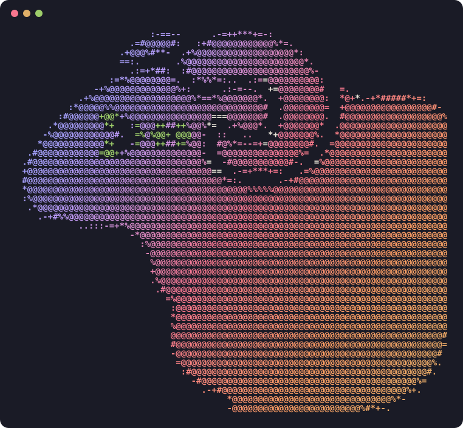</p>

<h1 align="center">Herdr Desktop: Theme Studio</h1>

One window for the [Herdr](https://herdr.dev) app's whole look: themes, every color token,
fonts, glass, pane frames, the agents list and an auto-hiding sidebar. A big live preview shows
every change before you keep it, and Save writes the files Herdr already redraws from. [RECIPE.md](RECIPE.md) is the brief to
build it from scratch.

## Install

Tell your agent (the line from [Theme Studio on herdr.dev/mods](https://herdr.dev/mods/agentic-tool-labs/herdr-theme-studio)):

```
Read ~/.config/herdr-app/AGENTS.md, then add this mod: herdr.dev/mods/agentic-tool-labs/herdr-theme-studio
```

It copies `mods/theme-studio/` into `~/.config/herdr-app/mods/` and merges `keys.json` into yours.
It also adds the palette icon beside Settings. On Herdr's own layout that means switching you to
your own copy of it (`<layout>-studio`); ⌃⇧L switches back. Then press `ctrl-shift-y` or the icon.
By hand: copy that folder yourself and add `"ctrl-shift-y": "mod.open:theme-studio"` to the `global` section of your `keys.json`.

Your agent will mention that the Studio runs programs and reads files outside its folder. It runs
`osascript` to blur the wallpaper and render Bloom, and it reads `.itermcolors` files in Downloads and on
the Desktop for import.

Requires Herdr app 0.1.13 or later on macOS (Frosted wallpaper and Bloom are macOS only).


**Working on the source:** `./install.sh` copies `mods/theme-studio` into `~/.config/herdr-app` and
binds `ctrl-shift-y` (needs node). `./install.sh --remove` takes both out; your themes, settings and
layouts stay. Re-run it after each edit: Herdr's hot reload doesn't follow symlinks, so it copies. An
open Studio window keeps its old build until you close and reopen it.

## Updating

From v0.6.1 the Studio updates itself. It checks the repo's latest
[release](https://github.com/agentic-tool-labs/herdr-theme-studio/releases) when it opens, and every
6 hours from the palette icon while it's closed. A newer one shows three ways: a dot on the palette
icon, a banner across the top of the Studio with **What's new** and **Update**, and a Herdr notice
(once per version; clicking it opens the Studio). **Update** downloads the release, has Herdr check
it, and swaps it in for `mods/theme-studio/`; Herdr reloads the Studio from the new files, and a
notice says it's done (or why it couldn't). [Settings](#settings) has **Check now** and an
**Auto-update** switch, which installs a release as soon as it's found but never while you have
unsaved changes.

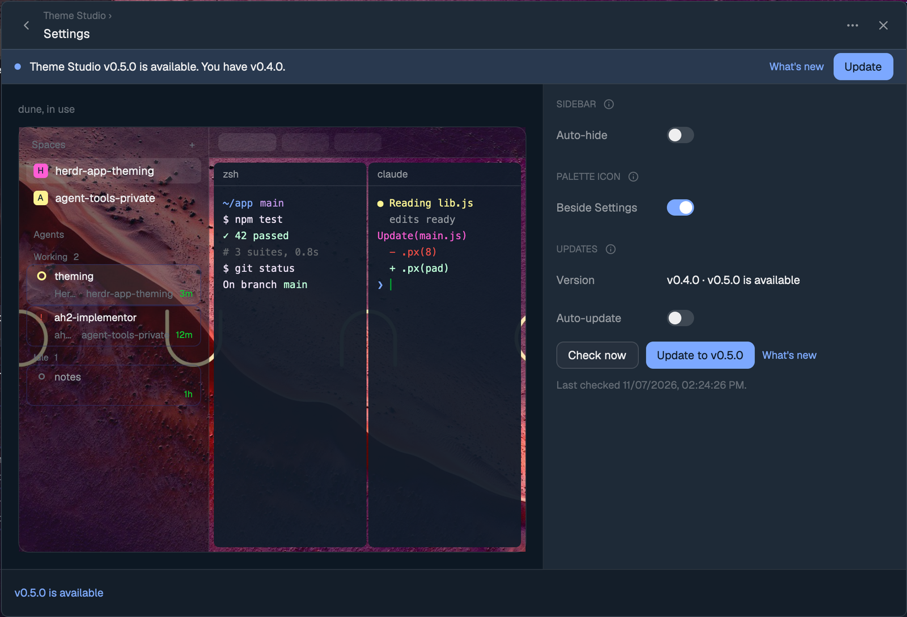

Your themes (with their saved type and glass), settings and layouts live outside that folder and
stay. On v0.5.0 or earlier, update once by hand: tell your agent "Update Theme Studio from
github.com/agentic-tool-labs/herdr-theme-studio: replace my `mods/theme-studio/` folder with the
repo's." Say "replace": by default an agent adds a second copy under a new name rather than
overwrite.

## Opening it

- **⌃⇧Y** toggles the window.
- **The palette icon beside Settings** in the sidebar footer. Herdr's Settings screen can't take
  extra sections (Herdr rewrites it on every start), and its sidebar mod and built-in layouts can't
  be edited. So the Studio makes your own copy of the layout (`<layout>-studio`) and a patched
  clone of the sidebar mod (`mods/workspace-chrome-studio`) for the footer only. The Studio's
  [Settings](#settings) page adds or removes it, as does `button=on|off`; on Herdr's own layout
  `button=on` makes your copy first. On the narrow sidebar rail it gets its own row under Settings.

## A tour

Every view has the same shape: a big preview of the whole window on the left and the controls on the
right. In the editor and Settings a bar along the bottom says what's going on and holds the buttons
that act on it.
The screenshots are of dune, with a picture as its window background.

### The theme library

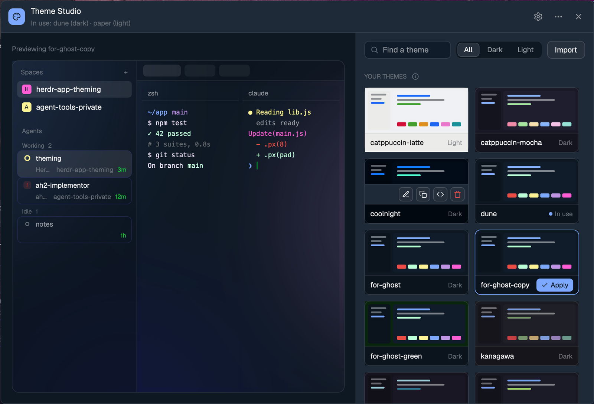

This is what opens. Click a theme to preview it on the left; nothing changes in the real window
until you apply it. Search by name, filter to Dark or Light, and the sections run Your themes,
Herdr's and others, then the 12 bundled presets (`presets/`, sources in `presets/SOURCES.md`).
Every action is on the card itself:

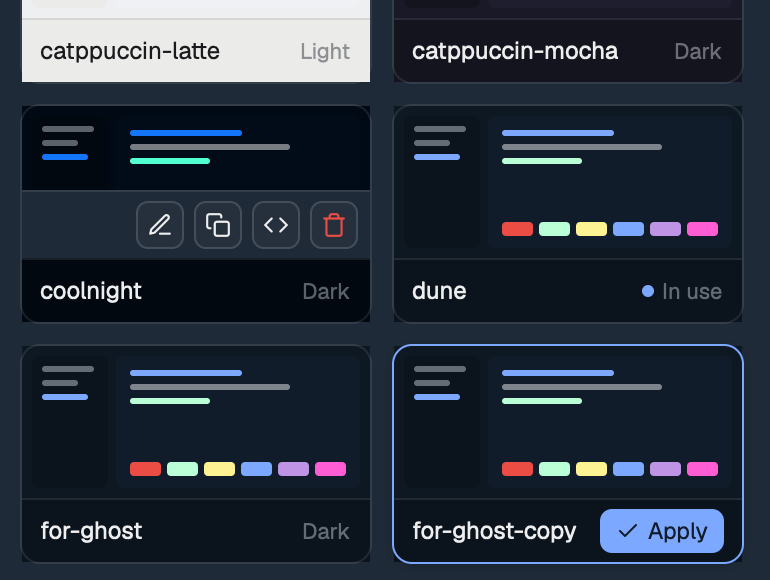

- **Apply**, on the card you picked, makes it the theme in use. Using a preset copies it into
  `themes/`, so Herdr's Settings lists it too. Click the theme in use to drop the preview.
- **Hover a card** for a strip of buttons along its bottom:
  - **Edit**. On one of Herdr's themes or a preset it's **Edit a copy**: you edit it straight
    away, and the first Save keeps your changes as `<name>-custom` (numbered if that's taken), so
    the original stays as it was.
  - **Duplicate…**: your own copy under a name you type.
  - **Copy JSON**: the theme in Herdr's format, for sharing.
  - **Delete…**: yours, when it's not in use.

  Duplicate and Delete ask in a bar that comes up along the bottom.

**A theme holds everything.** Its colors live in `themes/<name>.json`. Once you save it in the editor,
it also keeps its type, glass, cursor and agents-list settings, in shared state beside it.
Using the theme brings all of that back. A theme that has only colors (Herdr's, a preset, a fresh
import) leaves your type, glass and agents list as they are, and resets glass colors you set
by hex to the theme's own. Picking a dark theme sets dark mode's theme, and a light one sets light mode's.

The **⋯** at the top right has **Import a theme…**, **Show the themes folder** and **Undo all Theme
Studio changes…**, which restores `settings.json`, the layout and the theme picks from the snapshot
taken before the Studio's first write. Themes and layout copies it made stay on disk. The gear
opens [Settings](#settings).

### Importing

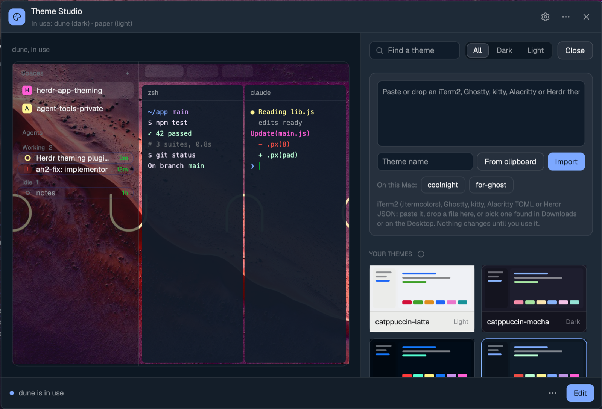

**Import** (beside the filter) takes iTerm2 (`.itermcolors`, binary or XML), Ghostty,
kitty, Alacritty (TOML) or Herdr JSON. You can paste the text, press **From clipboard** (a file copied in
Finder works too) or drop the file on the box. Any `.itermcolors` files in Downloads and on the Desktop are
listed under it for one click. An imported theme joins Your themes, and nothing changes until you
use it. The first time, macOS asks whether Herdr may read Downloads or the Desktop. That prompt can
hide behind other windows, and until you answer it the import seems to do nothing.

### The editor

**Edit** makes the theme the one in use and opens four tabs: Colors, Type, Glass and Agents. A
tab with unsaved changes has a dot. The preview shows every change as you make it, and nothing is
kept until **Save**. The bar along the bottom counts the changes and names their tabs; **Discard**
drops them, and the back arrow asks first when there are any.

#### Colors

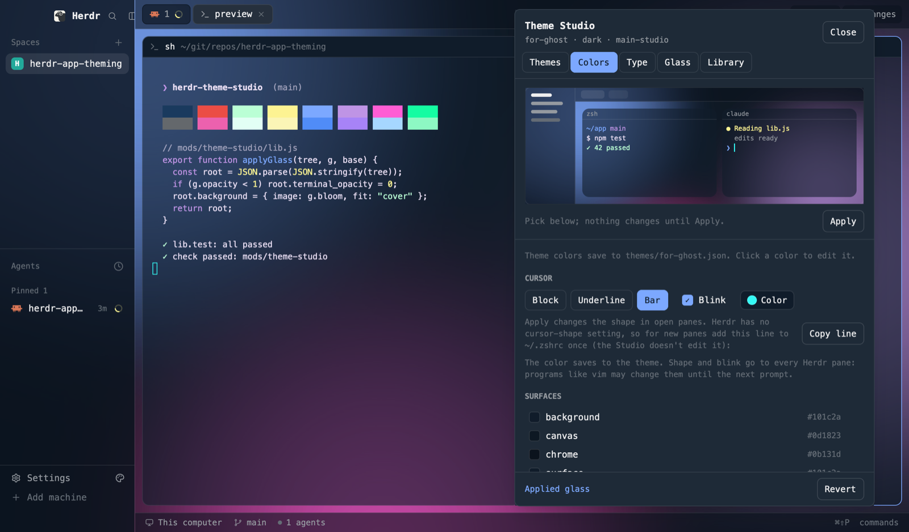

Click any color and its picker opens pinned at the top of the tab: a swatch, the hex, H, S, L and
A strips, a contrast badge for text colors, and ↺. ↺ undoes an unsaved change to that color; with
none, a color Herdr works out from the terminal colors goes back to that. Terminal colors (the
background, text, selection, cursor and the 16 ANSI colors) have nothing to go back to past their
saved value, so their ↺ is dimmed until you change them.

| Option | What it changes |
|---|---|
| Every theme token: Surfaces, Lines, Text, Accent, Agent status, Terminal ANSI | The token everywhere Herdr uses it. Saved to `themes/<name>.json`. |
| Behind panes | The color in the gaps and margin around the panes, as a theme token or a hex. It goes on the layout. |
| Cursor: Block, Underline, Bar; Blink; Color | The terminal cursor. The color is a theme token. Shape and blink go to every open pane. For new panes, add the line from **Copy line** to `~/.zshrc` once (see [Cursor shape](#cursor-shape)). |

#### Type

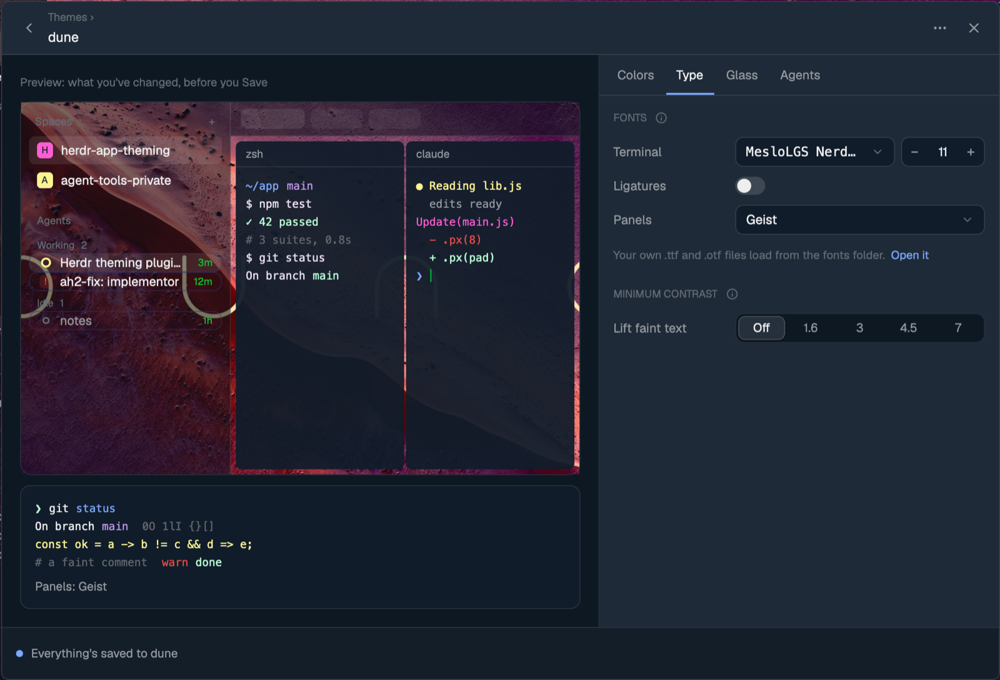

| Option | What it changes |
|---|---|
| Terminal font and size | `font` and `font_size` in `settings.json`. The menu draws each font in its own face. |
| Ligatures | `font_ligatures`: `!=` and `=>` join into single glyphs. |
| Panels | `ui_font`: the sidebar, tab bar and Herdr's panels (the preview's too). Their size follows Herdr's zoom (⌘+ / ⌘−). |
| Lift faint text: Off, 1.6, 3, 4.5, 7 | `minimum_contrast`: lifts terminal text that's too faint for its background. Off leaves programs' colors alone. |
| Open it (the fonts folder) | Herdr loads `.ttf` and `.otf` files from that folder without installing them system-wide. |

The sample terminal under the preview shows each pick at once. Herdr rereads `settings.json` only every few seconds
(up to about 10), so on your own layout copy the Studio also puts fonts and size on the layout for
15 s, and the window changes right away.

#### Glass

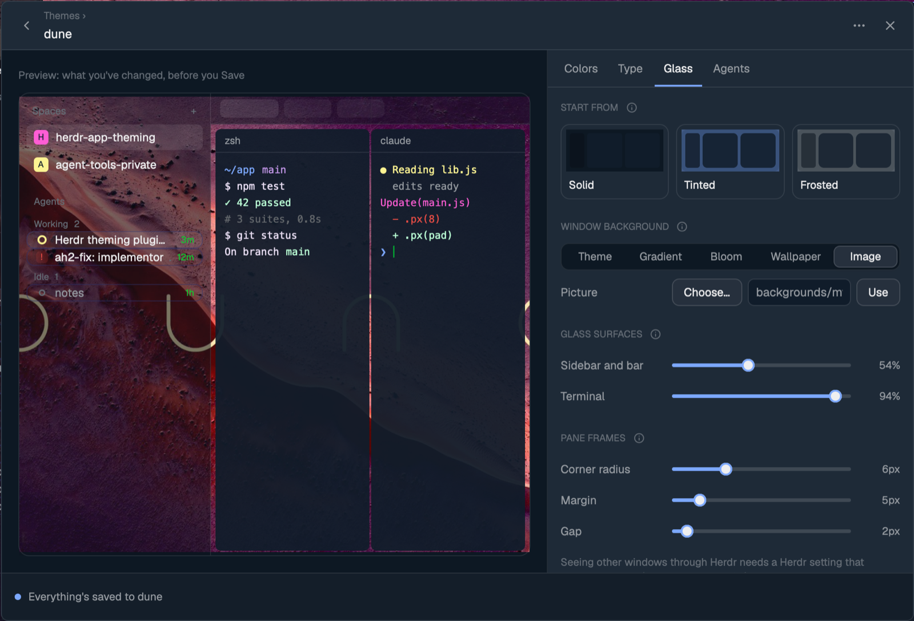

| Option | What it changes |
|---|---|
| Start from: Solid, Tinted, Frosted | Starting points that set everything below at once. |
| Window background: Theme, Gradient, Bloom, Wallpaper, Image | What shows behind the panes. **Gradient** uses two colors you pick and an angle. **Bloom** uses a base color with three soft glows, plus a glow strength; the preview follows a drag while the picture renders. **Wallpaper** is your desktop picture, blurred. **Image**: **Choose…** opens the macOS file picker, or you can drop a picture or type a path. A picture from outside Herdr's folder is copied into `backgrounds/`. |
| Sidebar and bar | How much of the background shows through the sidebar and tab bar. They keep the theme's chrome color. |
| Terminal | How much shows through the terminals. They keep the theme's background color. |
| Corner radius, Margin, Gap | The pane cards' shape and spacing. |

Herdr's own layouts refuse these fields, so on one of them the tab offers **Make my copy of <layout>**, your
own copy of the layout (`<layout>-studio`). The same panes, before and after:

| Solid (Tokyo Night as Herdr draws it) | Bloom, terminals at 0.72, sidebar at 0.6, radius 12 |
|---|---|
| 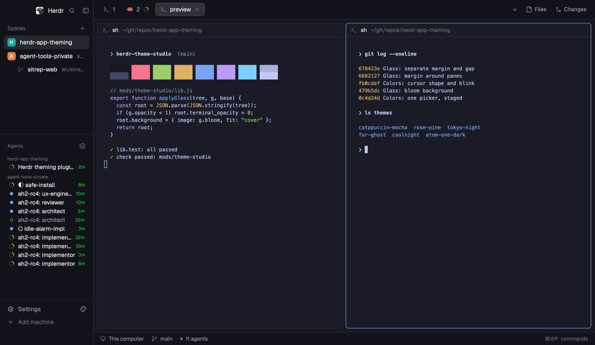 | 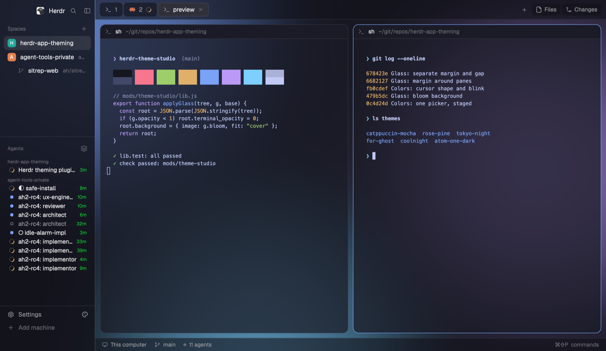 |

#### Agents

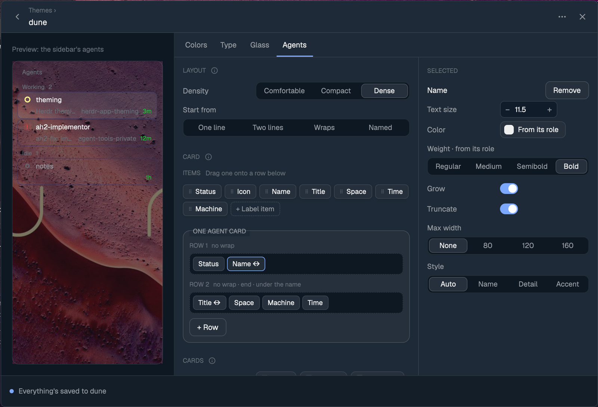

The sidebar's agents list. Herdr's own (left) and one with Compact density, cards, status on the left and
no icons (right):

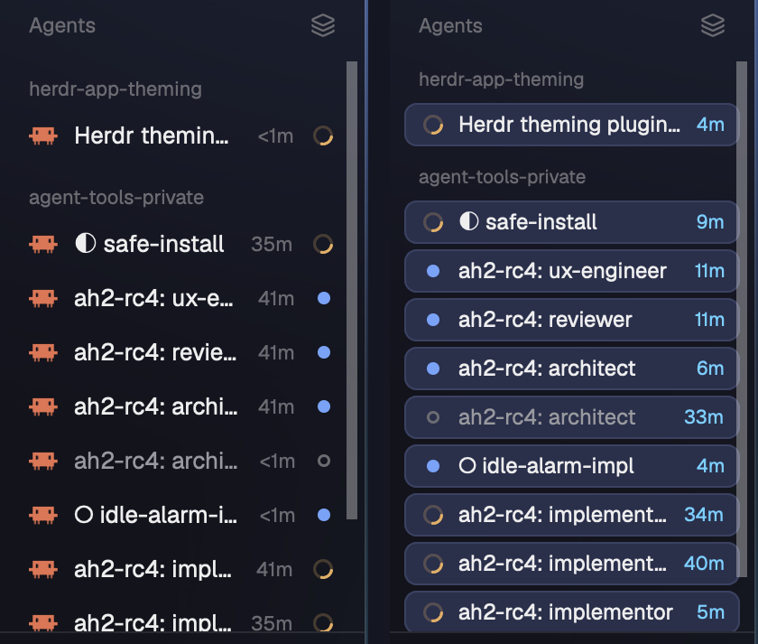

While you edit agents, the preview narrows to the sidebar's agents list, and the item you select
in the designer opens in a column on the right, so its settings never need a scroll.

**The card designer** lays out one agent card. Drag items from the palette onto its rows, drag
them along a row to reorder, or back onto the palette to take them off. The items:

- **Status**: the spinner, dot or "Needs you" badge.
- **Icon**: the agent's program icon.
- **Name**: the name you gave the session (below); without one, its title.
- **Title**: the title Claude Code writes for the chat.
- **Space**: the space name, hidden under its own group header.
- **Time**: the time since.
- **Machine**: for agents on another machine.
- **+ Label item**: a value from a Herdr terminal label (below), drawn as text or as a pill.

A row works like a web flex row: **Wrap**, **Justify** (start, center, between, end), **Gap**, and
**Under the name** to indent it past the icon. Each item has its own **Text size**, **Color** and
**Weight** (each with a Reset), plus **Grow**, **Truncate**, **Max width**, **Style** (whose look it
starts from: Auto, Name, Detail or Accent) and, for status, the badge. **Start from** sets up the rows: One line, Two lines, Wraps (two lines only when the name
won't fit), or Named (your name on top, Claude Code's title under it).

**Names and labels.** Claude Code stops writing a chat's title once you `/rename` it, so a Name
item that shows both needs a name kept somewhere else: a Herdr terminal label. Set one from
anywhere, or from inside the session, and the card shows it at once:

```sh
hc label "$HC_TERMINAL_ID" name=theme-studio   # set
hc label "$HC_TERMINAL_ID" name=               # remove
```

The Name item reads the `name` label, then a `/rename` name. A label item reads any key you
choose, with a prefix and, when it's missing, either nothing or a text you set.

| Option | What it changes |
|---|---|
| Density: Comfortable, Compact, Dense | Row and header heights, the icon size and every text size at once. Comfortable is Herdr's own. |
| Card: rows and items | The card designer above. |
| Cards: Card, Border, Selected, Hover colors | An unset color follows the theme; Card and Border are off until you pick one. The text colors are on each item. |
| Corner radius, Side padding, Spacing | The cards' shape and spacing, as number boxes. |
| Sizes (folded) | Row height, group header height, the group headers' and the "Agents" title's text, the badge. |
| Show | Group headers (Working, Pinned, …). Time, icons and the badge are items on the card. |

Weights other than Regular need the full Geist family (or another UI font): the Geist bundled with
Herdr draws every weight the same. Put Geist's static TTFs in `~/.config/herdr-app/fonts`; they
load at the next start or look change. The Weight control says so when they're missing.

Herdr's agents mod can't be edited. So once anything here differs from Herdr's look, your layout copy
shows `mods/agents-studio` instead: a copy of Herdr's list, rebuilt from Herdr's current one on each
Save, that reads these settings live. If a Herdr update changes the list too much to adjust, the
Studio says so and keeps Herdr's.

### Settings

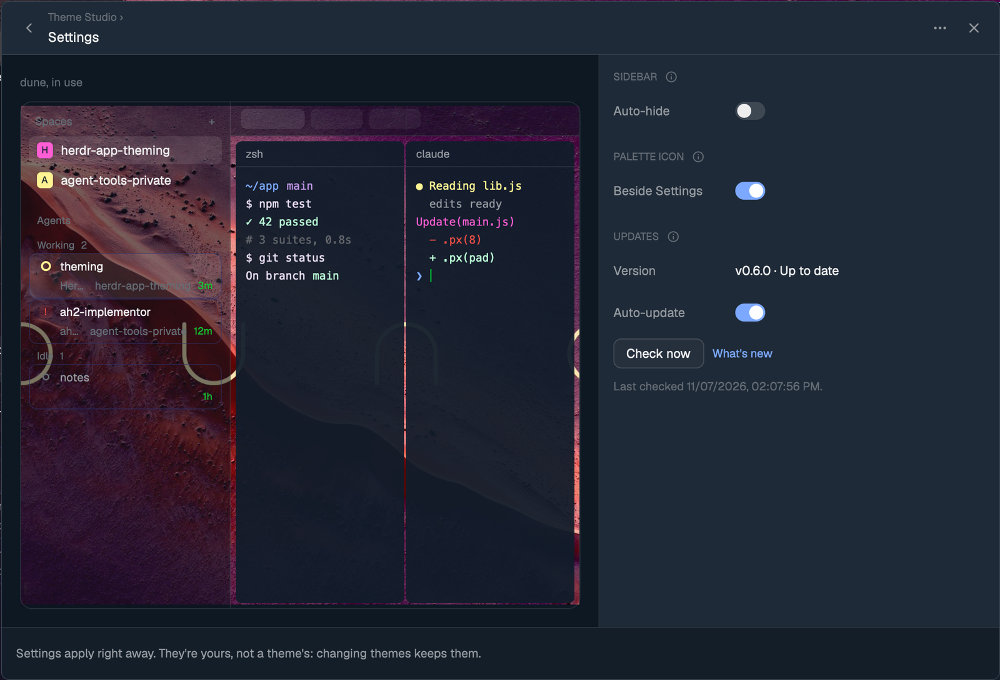

The gear in the library. These belong to you, not a theme, so changing themes keeps them, and
they apply at once.

| Option | What it does |
|---|---|
| Auto-hide | Keeps the sidebar out of the way until you need it. Rest the pointer on it and it opens, the terminals making room; move well past it and it folds back a moment later. A sidebar you open with Herdr's own fold button stays open, and dragging its edge never fights you. |
| Folds to: Minimal, Hidden | **Minimal** folds it to a 52px rail, room for each space's and agent's number and status dot. **Hidden** takes it away entirely; the window's left edge brings it back. |
| Beside Settings | The palette icon in the sidebar footer that opens the Studio. It shows a dot when an update is ready. |
| Updates | Your version and the latest release, **Check now**, **Update to v…**, **What's new**, and **Auto-update**. See [Updating](#updating). |

Auto-hide and the icon need your own copy of the layout, like Glass; Updates don't. Auto-hide is the sidebar folded (or hidden)
in the layout, plus an empty floating block from the Studio that watches the pointer; turning it
off takes both away. Herdr can't put its sidebar in a slide-over drawer (a mod can't hold another
mod's views), so it opens in place.

### Cursor shape

Herdr has no setting for it, but its terminals follow the escape code shells send (DECSCUSR). Save
sends it to every open pane and writes `cursor.zsh` and `cursor-shape` in `~/.config/herdr-app`.
For new panes, add the line the Colors tab copies for you to `~/.zshrc` once:
`[[ -r ~/.config/herdr-app/cursor.zsh ]] && source ~/.config/herdr-app/cursor.zsh` (with your full
path). The Studio never edits `~/.zshrc`. The hook re-sends the shape at each prompt in Herdr panes
(`TERM_PROGRAM=ghostty`), since programs such as vim change it.

## Glass: how it works and its limits

- **See-through terminals:** the terminal's own background goes fully transparent
  (`terminal_opacity: 0`), and the pane card carries the translucency (`pane.background` =
  the theme background with alpha). Herdr clips the card to its radius but paints a terminal's
  background square. Putting the alpha on the card is what keeps rounded corners clean.
- **Rounded headers:** Herdr's `pane` header paints a square background inside the rounded card.
  The Studio clones it once as `mods/pane-rounded` with its top corners following the card's radius,
  and uses that header while the radius is above 0. Herdr's own `pane` mod is untouched.
- **Behind panes** paints the node that holds the tab block. Herdr doesn't paint a tab block's own
  `background`.
- **Frosted wallpaper** blurs the desktop picture with Core Image (`frost.jxa.js`, no permission
  prompt) into `backgrounds/studio-frost-<time>.jpg`. It shows the wallpaper only, never the windows
  behind Herdr, and doesn't move with the window. It's rebuilt when the wallpaper changed and the Studio opens.
- **True window transparency** isn't possible from a mod. Herdr has no setting for it:
  [herdr-app#190](https://github.com/herdrdev/herdr-app/issues/190).
- A layout switch closes Herdr's overlay windows, so steps that span one (making the copy,
  Undo all) run as a detached `herdr-app do` script that also
  reopens the Studio.

## Commands

Bind any of these in `keys.json` as `"theme-studio:<command>"`, or run `herdr-app do theme-studio.<command>`
with the Studio open:

Library: `select=<name>` (preview; `apply` uses it) · `edit=<name>` · `copy=<from>:<new>` · `delete-theme=<name>` · `export=<name>` (JSON to the clipboard) · `view=themes|import|settings` · `menu=more|close` · `hover=<name>` (show a card's actions) ·
settings: `autohide=rail|hidden|off` · `button=on|off` · `update=check|install` · `autoupdate=on|off` ·
editor: `tab=<colors|type|glass|agents>` · `back` · `save` (or `apply`) · `discard` · `font=<family>` · `ui-font=<family>` · `size=<n>` (these three apply at once) ·
staged until `save` (`cancel` drops them): `color=<token>:<hex>` · `reset=<token>` · `stage=<key>:<value>` · `glass=Solid|Tinted|Frosted` ·
`bg=theme|gradient|bloom|frost|image` · `opacity|chrome|radius|margin|gap|angle|glowIntensity=<n>` · `behind=<token|hex|>` · `image=<path>` (no path: open the picker) · `glass-color=<from|to|bloomBase|glowA|glowB|glowC>:<hex|>` ·
`cursor=block|underline|bar` · `cursor-blink=on|off` · `agents=Comfortable|Compact|Dense` · `agents-row|text|icon|header=<n>` · `agents-time|headers|icons|badge=on|off` · `agents-lines=one|two|auto` · `agents-lead=space|session` · `agents-statusSide=left|right` · `agents-weight=normal|medium|semibold|bold` · `agents-radius|pad|space|detailText=<n>` · `agents-show=title|name|both` · `card=one|two|auto|both` (Start from) · `card-select=<row>.<i>` (or `<row>`) · `card-item=<key>:<value>` (the selected item) · `agents-nameColor|detailColor|timeColor|cardColor|borderColor|selectedColor|hoverColor=<hex|>` · `pick=<tok:token|glass:key>` (select a color for the picker) ·
`copy-layout` · `import=<name>` (from the clipboard) · `import-file=<path>` · `revert`

## Checks

```sh
node mods/theme-studio/lib.test.mjs          # pure logic: contrast, importers (incl. iTerm2 plist), glass and auto-hide tree edits, header patch
herdr-app check ~/.config/herdr-app/mods/theme-studio
```

## Files

```
install.sh
mods/theme-studio/
  main.js          the window, its views and the command API, and the auto-hide watcher
  lib.js           pure helpers, tested by lib.test.mjs
  frost.jxa.js     wallpaper blur (osascript -l JavaScript)
  bloom.jxa.js     bloom background render (base color plus three glows)
  palette.svg      sidebar icon
  icons/           the window's own icons (Lucide)
  presets/         12 theme files + SOURCES.md
docs/              design page source, the layout audition (design/), build plan, screenshots, the ASCII ram
RECIPE.md          the brief to build it from scratch
keys.json          the key it expects
```

## License

[MIT](LICENSE). The bundled theme palettes belong to their authors (MIT, Tokyo Night Apache-2.0): see
[presets/SOURCES.md](mods/theme-studio/presets/SOURCES.md).
