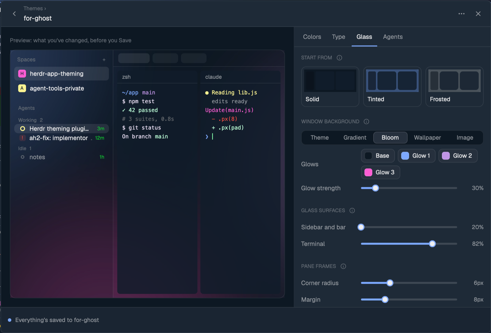

# Theme Studio

One floating window for the Herdr app's whole look: pick or import a theme, edit any of its
color tokens, choose terminal and panel fonts, and give the window glass: a gradient, image or
blurred-wallpaper background showing through translucent terminals and sidebars, with
rounded pane cards whose corners stay clean. Every change lands in the real window within a
second or two once saved, and a big preview shows them before that. Undo all puts back how
things were before the Studio's first change. A Settings page holds what isn't a theme's: an
auto-hiding sidebar and the palette icon.

## Adding it

For an agent adding this mod from herdr.dev/mods. After the usual steps (copy `mods/theme-studio/`,
merge `keys.json`, `herdr-app check`), also add the palette icon beside Settings, unless the
person said not to:

1. `herdr-app do mod.open '{"name":"theme-studio"}'` opens the Studio. It toggles, so run it once.
2. `herdr-app do theme-studio.button=on`. It answers once the Studio has loaded; retry for a few
   seconds until it does. On one of Herdr's own layouts this first makes the person's copy
   (`<layout>-studio`) and switches to it, since Herdr's layouts can't take the icon. The Studio
   closes for a moment, reopens on the copy, and adds the icon there.

Then tell the person: ⌃⇧Y or the palette icon opens the Studio; they're on their copy of the layout
(⌃⇧L switches back, and Herdr keeps updating everything else); the Studio's Settings page (the
gear) removes the icon.

## What you see

A window 1000×680 px (`mod.json` overlay, `kind: "window"`), on the `popover` background,
`foreground` text. Every view has the same three bands:

Two levels: the **theme library** (with an **import** panel and a **Settings** page), and the
**editor** for one theme, since a theme is built from the editor's four tabs.

- **Header**, 56px, a 1px `border` line below; pressing anywhere here drags the window.
  Library: a 32px palette tile, "Theme Studio" (13.5px semibold) over `In use: <dark> (dark) ·
  <light> (light)` (11px `dim`); on the right a gear (Settings), ⋯ and ×. Editor and Settings: a
  back arrow, then a `dim` breadcrumb (`Themes ›`, `Theme Studio ›`, clickable) over the theme's
  name or "Settings". Icon buttons are 30px, radius 8, a Lucide SVG at 16px in `muted`, `hover`
  under the pointer, a tooltip each.
- **Body**, a row: the **canvas** (flex, 18px padding, a 11.5px `dim` caption such as "Preview:
  what you've changed, before you Save" over the big mock window, and on the Type tab the sample
  terminal under it), a 1px `border` line, and the **inspector**, 400px, on `raised`. In the
  editor the inspector starts with the **tab bar**: Colors, Type, Glass, Agents as 12.5px text,
  the chosen one `foreground` with a 2px `accent` underline, a `working` dot on a tab with
  unsaved changes. Then the selected color's editor, pinned, then the tab's sections, scrolling.
- **Bar** along the bottom, 52px, a 1px `border` line above: a 7px status dot and one line of
  text on the left, the buttons that act on it on the right (primary `accent`, ghost, or plain).

Parts:

- **Section**: an 10.5px semibold uppercase `muted` label with an ⓘ that holds the explanation
  as a tooltip, an optional count ("· 4 sliders") and ▸ when it folds, then its rows, 10px apart.
- **Row**: a 112px 12.5px label, the control filling the rest, a 44px `dim` value on the right
  for sliders.
- **Slider**: a 4px `input` groove, `accent` fill, a 14px round `foreground` thumb ringed in
  `accent` (`ml(-7).mt(-5)`).
- **Seg** (a choice of a few): pills 24px high in a 1px `border` box on `canvas`; the chosen one
  `raised` with a shadow. **Toggle**: a 30×18 track, `accent` when on, a 14px knob.
- **Chip**: a 28px pill with a 14px color dot, for a color that opens the picker.
- **Mock window**, filling the canvas: the backdrop (canvas; the gradient as bands; the frost,
  bloom or image file at twice the box, centered, since `image()` only fits inside its box; while a
  Bloom picture renders, the glows drawn as rings from the recipe); a 210px sidebar (Spaces, then
  the agents list by the staged agents settings) and a 34px tab bar in the chrome color at its
  opacity, all in the staged panel font; two pane cards in the terminal color at its opacity, with
  the real radius, margin and gap over the behind color, text in the staged font, size,
  ligatures and ANSI colors, and the cursor in its shape and color.
- **Color editor** (one, for whichever color is selected, pinned at the top of its tab): a 40px
  swatch, the name over its token, a 96px hex input with **Set**, ↺ and ×; under it H, S, L and
  A strips (each a band of what that slider would give, a 14px ring thumb, the value on the
  right). ↺ undoes an unsaved change first; with none, a derived token goes back to the color
  Herdr works out (its override dropped); a terminal or ANSI color has nothing to go back to,
  so ↺ is dimmed and its tooltip says why. Text tokens get a contrast badge (`done` when the
  ratio meets 4.5, or 3 for `dim` and `accent`; `working` when not).

Views:

- **Library**: a search input, an All / Dark / Light seg and **Import**; then sections Your
  themes (files the Studio wrote or imported), Herdr's and others (the rest of `themes()`, minus
  themes named like a layout), Bundled presets (not yet installed). Cards are 176px little
  windows, radius 10: a 76px picture of the theme (a sidebar, lines in its text colors, six ANSI
  bars) over a caption with the name and Dark/Light, or "● In use". The picked card has an
  `accent` border. The bar: "Previewing <name>. Nothing's changed yet." or "<name> is in use",
  then **Cancel** (when previewing), ⋯ (Duplicate…, Copy JSON, Delete…), **Edit** or **Edit a
  copy** (not yours), **Use it** (when previewing). Duplicate swaps the bar for a name input with
  Cancel and Copy; Delete for "Delete <name>? Its file in themes/ goes too." with Keep it and
  Delete. The header's ⋯: Import a theme…, Show the themes folder, Undo all Theme Studio
  changes… (once a backup exists; the bar then asks before it runs).
- **Import**, a panel at the top of the library: a textarea that also takes a dropped file, a
  name input, **From clipboard**, **Import**, and the `.itermcolors` files found in Downloads and
  on the Desktop as chips. An import lands in Your themes, picked but not used.
- **Colors**: Cursor (Shape seg, Blink toggle, Color chip, and, until `~/.zshrc` sources
  `cursor.zsh`, a note with **Copy line**); token tiles 118px wide in groups (Surfaces, Lines,
  Text, Accent, Agent status), each a swatch over its label ("Terminal bg", "Needs you", …); the
  ANSI colors as Normal and Bright rows of eight; Behind panes as a seg of tokens plus a Custom
  chip. Values are the theme's own, not the layout's translucent overrides.
- **Type**: Terminal (a font picker and a − value + stepper, 8 to 32), Ligatures, Panels (a font
  picker), a line about the fonts folder with **Open it**, and Lift faint text (Off / 1.6 / 3 / 4.5
  / 7). A font picker is a trigger in its own font opening a 340px `Popup` with a filter input and
  a list of families each drawn in itself (monospaced-looking ones only for the terminal until
  you type). Herdr has no font weight, spacing, line height or anti-aliasing setting (its
  settings struct: zoom, sounds, core, font, font_size, font_ligatures, ui_font, telemetry,
  clipboard_write, pane_scrollbars, minimum_contrast, option_as_alt, appearance, theme, colors),
  so the tab doesn't offer them.
- **Glass**: on Herdr's own layouts, one card: "Glass needs your own copy of this layout" and
  **Make my copy of <layout>**. On a personal layout: Start from (Solid, Tinted, Frosted as
  little pictures, a check on the current one); Window background seg (Theme, Gradient, Bloom,
  Wallpaper, Image) with the matching rows under it (From and To chips plus the angle; Base, Glow
  1–3 chips plus Glow strength 0–200%; Rebuild; the image path and **Choose…**); Glass surfaces
  (Sidebar and bar 0.2–1, Terminal 0.3–1; their color is always the theme's chrome and terminal
  color); Pane frames (Corner radius 0–20, Margin 0–32, Gap 0–24); and a hint that true window
  transparency is herdr-app#190.
- **Agents**: Layout (Density, Rows, Title, Status segs), Cards (Name, Detail, Time, Card, Border,
  Selected, Hover chips; Name weight; Corner radius, Side padding, Spacing), and folded Sizes and
  Other text sliders, then Show toggles.
- **Settings**: Sidebar (Auto-hide toggle; when on, Folds to: Minimal / Hidden) and Palette icon
  (Beside Settings toggle). On Herdr's own layouts, the same make-a-copy card as Glass. The bar:
  "Settings apply right away. They're yours, not a theme's: changing themes keeps them."

On a personal layout with the icon: in the sidebar footer's Settings row, to the right of
"Settings", a 26px square button, radius 6, `palette.svg` at 14px in `muted`, `hover`
background and `foreground` under the pointer, the same as the sidebar header's buttons.
On the narrow sidebar rail (under 160px) it moves to its own 28px row under Settings, and the
footer block grows by that row (`layout.resize`), shrinking back when the sidebar widens.

## How it behaves

- **⌃⇧Y** (`keys.json`) toggles the window; the palette icon opens it. It doesn't take the
  keyboard when it opens. The last tab is remembered (shared `theme-studio.tab`).
- No agent statuses: the Studio is about the look, not the agents. The Agent status colors
  (`working`, `blocked`, `done`, `idle`, `unknown`) are editable tokens like any other.
- **Picking a theme** stages it (the mock window shows it; a preset's panel colors are guessed
  from its background until Herdr derives them). Use it runs `app.theme {name}`, which sets the
  half that matches its lightness; a preset is first written to `themes/<name>.json` and the
  Studio waits for `themes()` to list it. Glass colors set to a fixed hex (glows,
  gradient ends, behind panes) go back to their theme-following defaults in the same step, and
  translucent glass is pushed again: its colors are hexes of the theme's. Staging a theme drops
  staged color edits, which were for the old theme.
- **Setting a color** writes the theme file and then picks the theme again: Herdr reads a
  theme file only when it's picked. Panel tokens go in the file's `colors` block (Reset
  deletes them); `background`, `terminal_foreground`, `selection`, `cursor` and `ansiN` are
  the file's own fields. A theme the Studio didn't write opens in the editor all the same; the
  first Save forks it to `<name>-custom` (numbered when taken), and the editor follows the fork.
- **Type** writes `settings.json` (`font`, `font_size`, `ui_font`, `font_ligatures`,
  `minimum_contrast`), merged key by key through `writeTextFile(path, text, expected)` with
  one retry if the file changed under it.
- **A Studio theme** is its Herdr theme file plus, once saved in the editor, `{ type, glass,
  cursor }` in shared `theme-studio.themes` under its name (glass without rendered picture paths:
  Bloom and Frosted render again on apply, since old renders get deleted). Yours = names in
  `theme-studio.owned` that `themes()` lists; Herdr's and presets are forked on their first Save, so
  an original can't be changed by accident. Copy carries the extras along; Delete removes the
  file, the name and the extras, and refuses a theme in use.
- **Staging**: the library's pick, and the editor's Type, Colors and Glass controls, stage into
  drafts (theme pick, settings, theme tokens, glass, cursor); previews, sliders and the picker
  show them. Use it (library) or Save (editor) writes them in one guarded task: the theme pick
  with its saved type and cursor, `settings.json`, the theme file (all tokens in one write),
  then one `layout.set` of the whole personal tree (always after a new theme, so the file's root
  theme names it). Save then stores the theme's type, glass and cursor. Edit applies the theme
  first. Discard drops the drafts; the back arrow with drafts asks Save, Discard or Keep editing.
  Every after-step (the editor opening, Save's bookkeeping, Save-and-leave) takes the `cx` its
  task hands it: one captured from the click is dead by then and throws "cx is no longer valid". The editor survives a reopen (shared `theme-studio.editing`).
- **Cursor shape** isn't a Herdr setting; terminals take DECSCUSR (`ESC [ n SP q`: block 2,
  underline 4, bar 6, blinking one less). Save writes `cursor-shape` (the number) and
  `cursor.zsh` (a zsh precmd hook, only when `TERM_PROGRAM=ghostty`, that sends it) to the app
  home, keeps `{shape, blink}` in shared `theme-studio.cursor`, and writes the code to the tty of
  every herdr-core child process so open panes change at once. The Studio never edits
  `~/.zshrc`; it offers the `source` line to copy and checks whether it's there. The mock window
  draws the cursor after the last prompt.
- **Glass** colors (gradient From/To, bloom base and glows) are tokens or hex. Bloom colors
  can't be read back from the tree, so they're kept per layout in shared
  `theme-studio.glass-extra`.
- **Bloom**: Herdr paints only a color, a two-color linear gradient or a picture behind panes,
  and a mod can't draw behind them. So `bloom.jxa.js` renders the base color and three radial
  glows (Core Image, blurred 90px) into `backgrounds/studio-bloom-<time>.jpg`, 250 ms after the
  last change; until it's ready the preview draws the glows from the recipe, so it follows a drag. Re-rendered when the theme changes; old
  renders are deleted, all of them when the background leaves Bloom. **Make my copy** runs `layout.clone`, which
  switches layouts and so closes the window; a detached `herdr-app do` script reopens it,
  and the new copy (seeing shared `theme-studio.add-button`) adds the palette icon. Settings offers the same copy for the icon alone.
- **Frosted wallpaper** is rebuilt when the window opens and the wallpaper path has changed,
  or on Rebuild. Old `studio-frost-*.jpg` files are deleted.
- When the theme changes anywhere (a 1 s check), translucent chrome and cards are rewritten
  from the new theme's colors.
- **Auto-hide sidebar**: Herdr can't put its sidebar in a floating drawer (a mod's imports stay
  inside its own folder, so it can't mount another mod's views), so it opens in place. On, the
  layout's `sidebar` node gets `size.px` 52 (Minimal: a number and a status dot; `min` lowered to
  match) or `hidden: true` (Hidden), and `floating` gets `{ id: "studio-edge", content: { mod:
  "theme-studio", props: { part: "edge", mode } }, edge: "left", align: "end" }`, an empty block
  whose view only watches: a block hears the pointer only over itself, so it reads
  `window.mouse_position()` every 100 ms. Minimal: resting 200 ms on the rail (below its 46px top
  row, where the window buttons are) runs `layout.resize` to shared `sidebar.width` (Herdr's own
  fold key; 268 if unset); 600 ms more than 32px past the open sidebar folds it back. Hidden:
  x ≤ 4 runs `layout.show`, leaving runs `layout.hide`. It sets `sidebar.collapsed` like Herdr's
  fold button, leaves alone a sidebar it didn't open, and treats a width it didn't set as someone
  dragging the edge: it waits until the width has been still for a second, and keeps a dragged
  open width as `sidebar.width`. The layout is the state (no shared flag, so it survives a
  restart); Off removes the block and opens the sidebar. `withAutoHide` in lib.js.
- **Undo all** writes back the `settings.json` text saved before the first change, re-picks
  the saved dark and light themes, and switches back to the saved layout (via the detached
  script when that switch would close the window). Themes and layout copies stay.
- **Commands**: `herdr-app do theme-studio.<command>` or `"theme-studio:<command>"` in
  keys.json: `select=<name>` (or `theme=`), `edit=<name>`, `copy=<from>:<new>`,
  `delete-theme=<name>`, `export=<name>`, `view=themes|import|settings`, `menu=more|theme|close`,
  `autohide=rail|hidden|off`, `back`, `save`, `discard`,
  `tab=colors|type|glass|agents`, `agents=<preset>`, `agents-<key>=<n|on|off|value|hex>`, `color=<token>:<hex>`, `reset=`, `font=`, `ui-font=`,
  `size=`, `stage=<key>:<value>`, `glass-color=<key>:<hex|>`, `pick=<tok:token|glass:key>`,
  `cursor=block|underline|bar`, `cursor-blink=on|off`, `apply` (Save in the editor), `cancel`,
  `glass=Solid|Tinted|Frosted`, `bg=`, `opacity|chrome|radius|gap|angle=<n>`, `behind=`
  (the glass ones stage), `button=on|off`, `copy-layout`, `import=<name>` (clipboard),
  `import-file=<path>`, `image=<path>` (none: the picker), `revert`.
- **Agents list**: Herdr's `agents` mod draws it and can't be edited, so the Studio clones it as
  `mods/agents-studio` (`mod.clone`), then rebuilds the clone's `main.js` from Herdr's current one
  on each Save: `mods/agents/` paths and `mod: "agents"` overlays renamed, then eighteen exact
  replacements (`patchAgents` in lib.js; each anchor must match once, else it refuses and Herdr's
  list stays) that read `studioAgents()`, a helper merging `{ row: 30, text: 13, icon: 16, header:
  30, headerText: 11, timeText: 11, titleText: 11.5, badgeText: 10.5, time, headers, icons, badge:
  true }` with shared `theme-studio.agents`. The clone reads it on
  each render, so changes show at once. Every layout push swaps the agents block to the clone when
  any value differs from Herdr's, and back when none does. Presets (row/text/icon/header, then
  header/time/title/badge text): Comfortable 30/13/16/30, 11/11/11.5/10.5 (Herdr's); Compact
  24/12/14/24, 10.5/10.5/11/10; Dense 20/11.5/12/20, 10/10/10.5/9.5. The badge's height is its
  text plus 7.5, the "!" box its text plus 3.5. Sub-agent rows follow at row
  minus 4, text minus 0.5, icon minus 2. Saved with the theme like glass.
  `lines` is "one" (Herdr's row), "two", or "auto": an inserted branch after the row's `const name`
  returns a two-line row (icon, name and fold on top; the detail, machine, time or pin, and status
  under the name, indented by the icon and gap). "auto" takes it when the name (plus " · detail")
  at about 0.56em a character won't fit the sidebar width less padding, icon, time and status;
  mods can't measure text. The mock list uses the same rule for its 240px.
  `lead` "space" (Herdr's) or "session": where a row names both (grouped by status, or pinned), the
  name and detail swap so the session's title leads. Cards: `nameColor`, `detailColor`,
  `timeColor`, `cardColor`, `borderColor`, `selectedColor`, `hoverColor` ("" is the theme's
  foreground, dim, dim, none, none, selected, hover; a set name color also covers idle rows),
  `weight` normal|medium|semibold|bold for the name, `radius` 8, `pad` 8 (side padding), `space` 0
  (gap in the list), `detailText` 11 (the second line's detail), and `statusSide` "right" or
  "left": left puts the compact status (spinner, dot or !) in a 16px box before the icon, and a
  two-line row's second line indents past it too. The tab's color chips use the Glass tab's
  picker (`pick=agent:<key>`); the mock list shows all of it.
  Herdr doesn't reload a mounted clone whose file changed, so when Save rewrites the clone while
  the layout uses it, the Studio sets Herdr's list for 1.2 s and then the clone again.
- **Image background**: Herdr gives mods no file dialog, so **Choose…** runs
  `osascript -e 'POSIX path of (choose file of type {"public.image"} ...)'` (cancel returns nothing).
  The row also takes a dropped file. Layouts read pictures only inside Herdr's folder, so a
  picture from elsewhere is copied into `backgrounds/` (a time prefix when the name is taken).

## Built from

- `mods/theme-studio/mod.json`: `{ "place": "none", "title": "Theme Studio", "overlay":
  { "kind": "window", "width": 1000, "height": 680 } }`.
- `main.js`: one `View`. A block with `props().part === "button"` (an older sidebar row) draws
  nothing and skips all setup, because a second copy must not also answer commands; one with
  `part === "edge"` draws nothing and only runs the auto-hide watcher. `gpui-kit`: `View`, `div`, `svg`, `image`;
  `gpui-base`: `v_flex`, `h_flex`, `InputState`/`Input`, `TextareaState`/`Textarea`,
  `SliderState`/`Slider`/`SliderTrack`/`SliderIndicator`/`SliderThumb` (all four parts, or
  the slider can't move). `herdr`: `theme`, `themes`, `settings`, `fonts`, `layout`,
  `layouts`, `nextCommand`, `shared`/`setShared`, `run` (`app.theme`, `layout.set`,
  `layout.clone`, `layout.switch`, `mod.clone`, `mod.open`), `exec`, `appHome`, `props`,
  `closeOverlay`, `readTextFile`/`writeTextFile`; `fs/promises` for presets and backgrounds;
  `cx.write_to_clipboard`/`read_from_clipboard`.
- `lib.js`: pure, tested by `node mods/theme-studio/lib.test.mjs`: `contrast` (WCAG,
  translucent text composited first), `withAlpha`, `normHex`, `mergeSettings`,
  `themeFileFrom` (theme() colors → a theme file), `setToken`, `parseTheme` (iTerm2 plist,
  Ghostty `palette = N=#hex`, kitty `colorN #hex`, Alacritty `[colors.normal|bright]`, Herdr
  JSON), `applyGlass`/`readGlass`, `withButton`/`hasButton`, `patchHeader`, `sortFonts`, `hexToHsla`/`hslaToHex`, `bloomSpec`, `cursorCode`.
- `frost.jxa.js`: `osascript -l JavaScript frost.jxa.js <out.jpg> 40 -0.15 1.2`. NSWorkspace
  gives the desktop picture (no permission prompt); Core Image scales it to 1600px wide,
  Gaussian-blurs it (clamped, then cropped back) and dims it; it prints
  `{ok, wallpaper, out}`.
- `presets/`: 12 theme files (`background`, `foreground`, `selection`, `cursor`, `ansi[16]`),
  sources in `presets/SOURCES.md`. `palette.svg`: a 16px palette outline in `currentColor`.
- What `applyGlass` writes to a layout: root `background` (`"canvas"`, `{gradient: ["accent",
  "canvas"], angle}`, or `{image, fit: "cover"}`), root `terminal_opacity: 0` when see-through,
  root `colors.chrome` = the theme's chrome with alpha; on each `{tab: "active"}` block's
  `pane`: `radius`, `gap`, `background` = the theme's background with the opacity as alpha,
  and the header mod swapped to `pane-rounded` while the radius is above 0; on the tab block's
  parent: `background` = the behind-panes color, `padding` = the margin, `gap` = the gap. Herdr's
  pane `gap` shows only between split panes, so a lone pane's margin is that parent's padding.
- `workspace-chrome-studio`: `mod.clone {name: "workspace-chrome"}`, then `patchFooter` adds a
  `studioIcon(t)` helper and wraps the footer's Settings row in an `h_flex` with
  `.when(!collapsed, el => el.child(studioIcon(t)))`, plus `studioRail(t)` under it on the rail and
  `studioFit(cx)` at the top of `render` for the footer height. It is rebuilt from Herdr's current
  `workspace-chrome` each time the icon is added, and Herdr doesn't reload a mounted clone it
  wrote, so the Studio remounts the footer after a rewrite. `withFooterIcon` points the layout's
  `sidebar-footer` block at it (the `brand` block stays on Herdr's own).
- `pane-rounded`: `mod.clone {name: "pane"}`, then `patchHeader` adds a `studioRadius()`
  helper (the tab block's `pane.radius` less its border width) and `.rounded_t(studioRadius())`
  on the header's root.
- Shared keys: `theme-studio.tab`, `.owned` (themes the Studio wrote), `.backup`, `.looks`,
  `.wallpaper`, `.add-button`.

## Watch out

- Herdr's Settings screen (`frame/settings`) and its shipped mods are rewritten on every
  start; the only lasting way in is a clone the personal layout points at.
- Herdr's own layouts take only click and look fields through `layout.set`, and of the
  look only `background`. `terminal_opacity` and `pane` are refused, and `terminal_opacity`
  in `settings.json` is ignored. Glass needs a personal copy.
- A `layout.set` built from `layouts/.state/<name>.json`'s `file` drops the layout's clicks
  (sidebar width, stack choice). Build from `layout()`.
- Herdr paints a terminal's background square inside a rounded card, so `terminal_opacity`
  below 1 gives sharp dark corners. Put the alpha on `pane.background` (which Herdr clips to
  the radius) and set `terminal_opacity` to 0. The shipped `pane` header has square corners
  too, hence `pane-rounded`.
- A tab block's own `background` isn't painted. Paint its parent.
- A layout switch (`layout.clone`, `layout.switch`) closes every overlay window and ends its
  tasks; anything after it must run outside the mod.
- Theme file edits don't show until the theme is picked again.
- File edits to a layout take about 4 s to show; `layout.set` about 1 s. Font changes in
  settings take a few seconds.
- Hot reload doesn't follow a symlinked mod folder, and an open window keeps its old build
  until it's closed and opened again.
- `structuredClone` isn't there; copy trees with JSON. Slider `set_value` from `render` is a
  side effect; sync sliders from a timer or a handler.
- Downloads and Desktop are privacy-protected: the first read from Herdr (`plutil`, `readdir`,
  `readTextFile`) waits on a macOS permission prompt, which can sit behind other windows. Until
  it's answered the import looks like it did nothing. iTerm2 also saves `.itermcolors` as a
  binary plist sometimes, and newer themes may carry only `(Dark)`/`(Light)` variants of each key.
- Herdr rereads `settings.json` on a poll, measured at 0.1 to 10.4 s, and no command forces it
  (`app.theme`, `layout.switch` and a no-op `layout.set` don't; zoom keys rewrite the file from
  memory and lose the change). A personal layout's `font`/`font_size`/`ui_font` apply at once, so
  the Type tab also sets them there and removes them 15 s later (shared `theme-studio.held`).
  Ligatures and `minimum_contrast` exist only in settings.json, so the Type tab stages picks
  in a sample (ligatures broken with U+200C when off, since gpui-kit has no font-feature
  switch; colors lifted by `liftContrast`) and writes them on Save.
  `settings()` reports the layout's look, so it can't tell when the file was read.
- `"code"` in a font-name filter catches "Arial Unicode MS"; match it as a word.
- True see-through windows need a Herdr setting that doesn't exist yet (herdr-app#190). The
  frosted wallpaper shows the wallpaper only and doesn't follow the window.

## Done when

- `node mods/theme-studio/lib.test.mjs` passes, and fails when an importer is broken.
- `herdr-app check ~/.config/herdr-app/mods/theme-studio` passes.
- ⌃⇧Y opens the window; `theme=tokyo-night` writes `themes/tokyo-night.json` and the
  window turns Tokyo Night.
- `color=accent:#bb9af7` shows the new accent on the focused pane's border within 3 s.
- `size=15` and `font=Menlo` change the terminal text.
- On `main`, Settings offers a copy; after it the window reopens on `main-studio` with a
  palette icon beside Settings that opens the Studio.
- `autohide=rail` folds the sidebar to 52px; resting the pointer on it opens it, moving well past
  folds it back, and dragging its edge doesn't flicker. `autohide=off` puts it back.
- `glass=Frosted` gives a blurred-wallpaper background, translucent sidebar and terminals,
  and rounded pane corners with nothing square showing at any corner.
- Importing an iTerm2 `.itermcolors` file (XML or binary, by drop, list, or a copied Finder
  path) gives the same background, foreground and ANSI colors as the scheme.
- `revert` leaves `settings.json` byte-identical to before and the original layout and
  themes showing.
